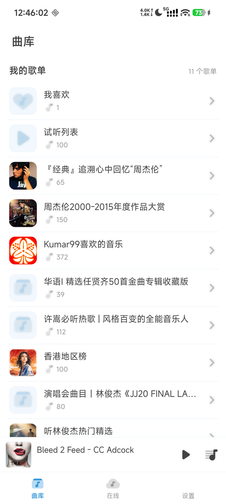
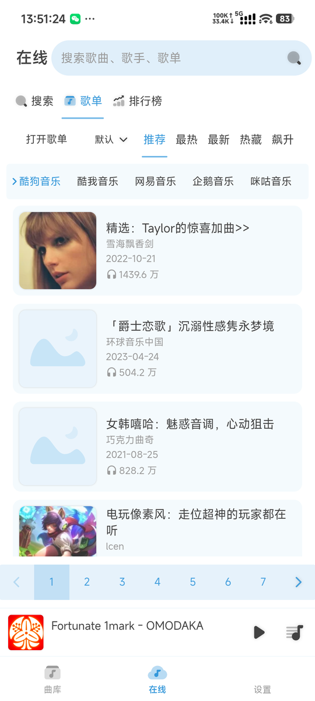
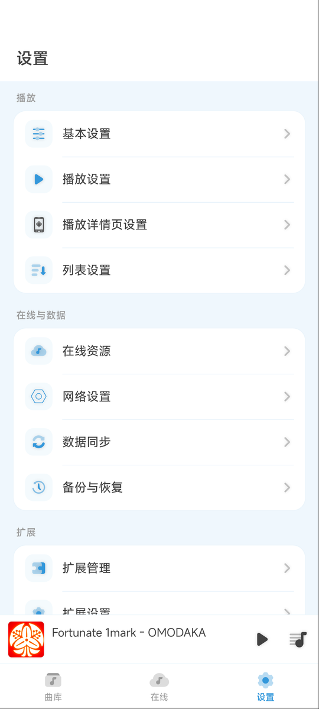

<p align="center">
  
</p>

<h1 align="center">Any Listen for Android</h1>

<p align="center">
  把完整的 Any Listen 音乐库装进手机。<br>
  离线播放、在线聚合搜索、扩展系统，全部在设备内运行。
</p>

<p align="center">
  
  <a href="https://github.com/g95809080-cmyk/any-listen/releases/latest"></a>
  <a href="LICENSE"></a>
  <a href="https://github.com/g95809080-cmyk/any-listen/actions/workflows/build-android.yml"></a>
</p>

> 非官方 Android 移植，基于 [Any Listen](https://github.com/any-listen/any-listen)。当前面向个人使用与学习。

<table>
  <tr>
    <td align="center"><br><sub>曲库</sub></td>
    <td align="center"><br><sub>播放详情</sub></td>
    <td align="center"><br><sub>在线歌单</sub></td>
    <td align="center"><br><sub>设置</sub></td>
  </tr>
</table>

## 项目简介

Any Listen 原本运行在桌面和 Web 服务端。本项目把同一套曲库、播放器、扩展系统和 Svelte 前端带进 Android：前端运行在 WebView，文件、SQLite、HTTP、音频和通知等能力由 Kotlin 宿主提供。

它不依赖电脑，也不需要单独搭一台服务器。安装后，曲库索引、数据库、本地 HTTP 服务和扩展沙箱都在手机内运行；本地音乐可以完全离线播放，在线内容则由你安装的音源扩展提供。

- **设备内运行**：没有远程后端，播放不依赖局域网或电脑。
- **保留扩展生态**：支持 Any Listen 扩展商店、本地 `.alix` 安装和 LX Music 自定义源。
- **为触屏重做**：底部导航、一级/二级页面、播放队列、触控列表和移动端设置，而不是把桌面界面缩进手机。

## 功能

| 模块 | 能力 |
|---|---|
| 本地曲库 | 导入本地音乐，管理歌单、收藏与试听列表 |
| 播放 | 后台播放、系统媒体通知与锁屏控制、播放队列、歌词、倍速 |
| 在线 | 聚合酷狗、酷我、网易、腾讯、咪咕的歌曲、歌单和排行榜；播放后可缓存到本地离线复听 |
| 扩展 | 扩展商店、本地安装、LX Music 自定义源批量导入；最多同时启用 3 个源 |
| 数据 | 歌单与设置一起备份、恢复 |
| 外观 | 浅色、深色与多套主题；底部导航和安全区适配 |

在线播放取决于扩展能力。只有搜索、封面或歌词能力的扩展不能单独播放；需要安装能够取得 `musicUrl` 的音源扩展。

## 安装

需要 **Android 10（API 29）或更新版本**，目标设备为 `arm64-v8a`。

仓库不提交二进制文件。推荐直接下载 [v1.0.0-android.1 Release](https://github.com/g95809080-cmyk/any-listen/releases/tag/v1.0.0-android.1)，附件包含：

- `anylisten-android-1.0.0-android.1-debug.apk`
- `lx-api-source-loader-android_0.1.7-android.1.alix`
- `BUILD-INFO.txt`
- `SHA256SUMS.txt`

想获取后续构建，也可以在 GitHub Actions 下载最新产物：

1. 打开 [Build Android APK](https://github.com/g95809080-cmyk/any-listen/actions/workflows/build-android.yml)。
2. 选择最近一次成功的运行。
3. 在页面底部下载 `anylisten-android-debug`。

自行构建后的文件位于：

| 类型 | 路径 | 说明 |
|---|---|---|
| Debug | `porting/android/app/build/outputs/apk/debug/app-debug.apk` | 日常安装和调试 |
| Release | `porting/android/app/build/outputs/apk/release/app-release.apk` | R8 裁剪，当前仍使用调试签名，仅适合个人安装 |

安装包不包含任何第三方音源。首次启动请按提示授予音乐文件访问权限。

## 开始使用

1. 打开「曲库」，导入本地音乐或进入已有歌单。
2. 需要在线内容时，进入「设置 → 扩展管理」，安装并启用音源扩展。
3. 在「在线」搜索歌曲，或浏览歌单、排行榜。
4. 在「设置 → 备份与恢复」中导出歌单和设置，避免换机或重装后丢失。

## LX Music 自定义源

仓库包含适用于 Android 的 LX Music 自定义源加载器，支持一次选择多个 `.js` 源、全选当前目录，以及继续从其他目录导入。

先构建扩展安装包：

```bash
cd porting/extensions/lx-api-source-loader
pnpm install --frozen-lockfile
pnpm build
```

产物位于 `artifacts/lx-loader/*.alix`。然后：

1. 进入「设置 → 扩展管理 → 本地安装」，选择生成的 `.alix`。
2. 进入「设置 → 扩展设置 → LX Music API Source Loader (Android)」。
3. 点击「导入本地自定义源」，多选或全选 `.js` 文件；结果页可以继续选择其他目录。
4. 勾选需要启用的源。当前最多同时启用 3 个，启用顺序决定优先级。
5. 保持「启用歌曲缓存」开启。歌曲播放时会后台保存完整音频，下载完成后可在断网状态复听。
6. 安装支持搜索的扩展后，在「在线」搜索并播放。

导入成功只表示源文件已经保存，第三方音源本身能否播放取决于它的服务状态。缓存保存在应用私有目录，卸载应用会一并删除；首次播放需要等完整文件下载完成后才能离线复听。适配扩展使用独立 ID，不会覆盖官方扩展的数据；已有官方扩展的音源可以先导出，再导入这里。

扩展的目录结构、构建输出和修改说明见 [`porting/extensions/lx-api-source-loader/README.md`](porting/extensions/lx-api-source-loader/README.md)。

## 从源码构建

完整步骤、工具链版本和常见问题见 [`docs/BUILD-from-source.md`](docs/BUILD-from-source.md)。

### 环境要求

- Node.js 22+；构建 LX 扩展需要 22.18+
- pnpm 10.34.5
- JDK 17
- Android SDK 35，`minSdk 29`

### 构建命令

```bash
git clone https://github.com/g95809080-cmyk/any-listen.git
cd any-listen

# 上游源码固定在 c8f40eab，必须放在仓库根目录的 source/
git clone https://github.com/any-listen/any-listen.git source
git -C source checkout c8f40eab05021735b969e5991e6ec2f2c63e83b8

cd source
pnpm install --frozen-lockfile --ignore-scripts

cd ../porting/js
pnpm install --frozen-lockfile
pnpm build:all

cd ../android
export ANDROID_HOME=/path/to/Android/Sdk   # Windows 使用 local.properties 或设置环境变量
./gradlew :app:assembleDebug -PrequireWeb=true -PskipWeb=true
# 可选：构建经过 R8 裁剪的 release 包
./gradlew :app:assembleRelease -PrequireWeb=true -PskipWeb=true
```

首次 `pnpm build:all` 通常需要十几分钟。`dist/` 是共享构建目录，不要同时运行两个 `build:all`。Windows 下把 `./gradlew` 换成 `gradlew.bat`。

`source/` 已被 `.gitignore` 排除，不会提交进本仓库。它必须位于仓库根目录，和 `porting/` 并列；换位置会导致 Vite 覆写和构建脚本找不到上游。

## 技术架构

```text
WebView（Svelte 5 UI + Web Audio）
        │ MessagePort
core.worker（上游业务模块 + 本地 HTTP 服务）
   ├─ db.worker    SQLite → sql.js（WASM）
   ├─ util.worker  文件遍历 / 元数据解析
   └─ ext.worker   扩展沙箱 → QuickJS（WASM）
        │ Ports
Kotlin 宿主（文件系统 / HTTP / 媒体 / 通知 / 生命周期）
```

上游 `source/` 保持零改动。Android 需要的平台替换集中在 `porting/js`，通过 Vite 的模块覆写表在构建期生效；原生能力由 `porting/android` 的 Kotlin 端口层提供。数据库和扩展沙箱都使用 WASM，因此 APK 不包含 `.so`。

## 项目结构

| 路径 | 内容 |
|---|---|
| `porting/js/` | Svelte UI、4 个 worker、Ports 适配和移动端覆写 |
| `porting/android/` | Kotlin 宿主、本地 HTTP 服务、播放服务与图标资源 |
| `porting/extensions/lx-api-source-loader/` | LX Music 自定义源 Android 适配扩展 |
| `docs/` | 构建、架构、UI、验收和许可文档 |
| `source/` | 上游 Any Listen 源码，构建前按固定 commit 检出，不入库 |

## 当前状态

已在 Xiaomi 2211133C / Android 16（392×872 CSS 视口）和 API 36 模拟器完成真机验收，覆盖本地播放、在线搜索、媒体会话、备份恢复、扩展安装和 LX 自定义源批量导入。

当前边界：

- Android 10–15、横屏、平板、折叠屏和外接指针尚未系统覆盖。
- 在线专辑、歌手搜索仍缺少对应的扩展接口。
- 文件选择依赖系统文件路径和所有文件访问权限。
- 第三方音源可能持续返回 400/503，或无法匹配播放地址；应用侧不能保证恢复。
- 明文网络只放行白名单主机，音源升级后可能需要同步调整。

更完整的测试记录和已知问题见 [`docs/phase5-acceptance-report.md`](docs/phase5-acceptance-report.md)。

## 开发文档

| 文档 | 内容 |
|---|---|
| [`docs/BUILD-from-source.md`](docs/BUILD-from-source.md) | 从零构建与产物校验 |
| [`docs/phase2-architecture.md`](docs/phase2-architecture.md) | 模块划分、Ports 接口和运行拓扑 |
| [`docs/phase3-uiux.md`](docs/phase3-uiux.md) | 移动端交互与布局规格 |
| [`docs/porting-decision-record.md`](docs/porting-decision-record.md) | 关键技术决策与问题复盘 |
| [`docs/phase5-acceptance-report.md`](docs/phase5-acceptance-report.md) | 验收范围、实测记录和遗留问题 |
| [`docs/phase6-compliance.md`](docs/phase6-compliance.md) | 上游零改动验证与许可材料 |

## 致谢与许可

- 上游项目：[Any Listen](https://github.com/any-listen/any-listen)
- LX 源适配参考：[Any Listen LX API Source Loader 0.1.7](https://github.com/any-listen/any-listen-extension-lx-api-source-loader)

本项目是 Any Listen 的衍生作品，沿用上游 **AGPL-3.0 + Additional License Terms**。附加条款禁止商业使用，本项目不提供额外授权。完整许可见 [`LICENSE`](LICENSE)，修改声明和对应源码获取方式见 [`NOTICE`](NOTICE)。
